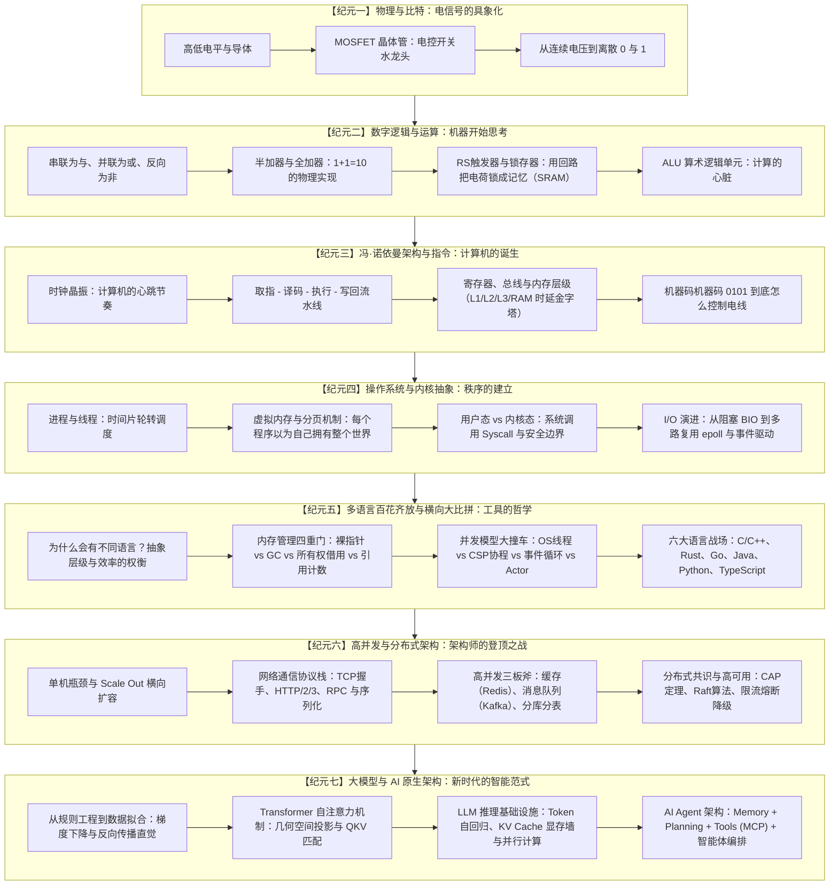
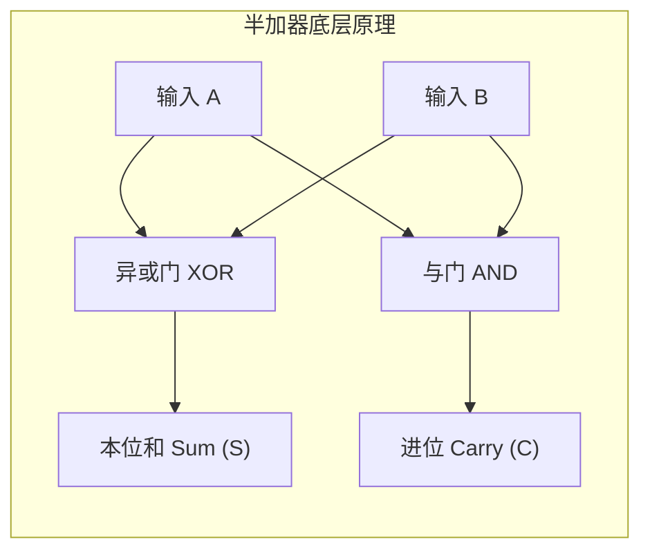
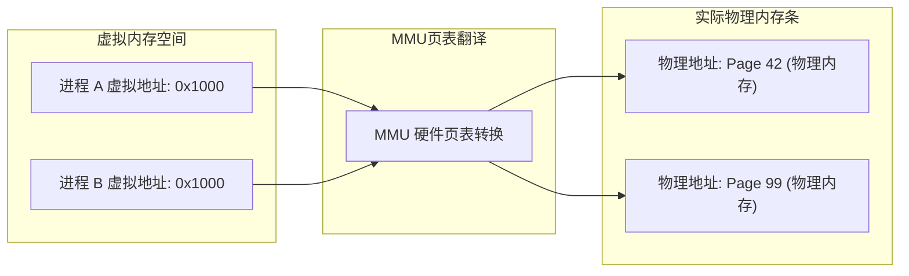

# 从零小白到系统架构大拿：代码世界终极演进体系与实操蓝图

> **核心宗旨**：拒绝浮躁草率，拒绝死记硬背。用第一性原理与生动图解，把深奥的计算机科学与现代架构拆解为“小白也能看懂”的因果链条；在每一个关键跃迁点提供多语言横向对照与动手实操沙盘，真正实现从“物理通断”一路登顶“大模型与分布式系统架构师”。

---

## 一、 为什么之前的 MVP 会让人感觉“草率”？

在现有的 5 段简化版中，存在三个致命的**“认知断崖”**：
1. **电平到逻辑门断崖**：点了 3 个开关亮了灯，下一秒直接弹出 AND 门，没有讲清楚**为什么两个开关并联就是 OR、串联就是 AND**，更没有展示**加法怎么凭空被算出来**。
2. **门电路到 CPU 断崖**：刚懂 AND/OR，瞬间跳到了 `LOAD R0, 1` 指令，中间缺失了：时钟震荡器、锁存器（内存的前身）、译码器、总线。机器码怎么变成了电信号？完全是黑盒。
3. **CPU 到 AI 断崖**：刚单步执行了一个加法，下一秒突然跳到了神经网络和 Transformer 注意力！中间缺失了整整 50 年的计算机文明：**操作系统（进程/虚拟内存）、编程语言生态（C/Rust/Go/Java/Python/TS 的诞生与分化）、数据结构、高并发与分布式系统架构**。

**真正的架构师之路，不能有任何黑盒！**

---

## 二、 整体设计全景图：七大纪元进化史

---

## 三、 第一性原理：各纪元“小白变大拿”图解教学法

### 1. 纪元一与二：物理电平到全加器运算
* **痛点**：“为什么通电就能算数？”
* **图解方式**：
  * **MOSFET 水龙头模型**：栅极（Gate）就像水龙头旋钮。施加高电压（1），闸门抬起，水（电流）从漏极流向源极；施加低电压（0），闸门关闭，水断流。
  * **1+1=2 是怎么发生的**：
    * 两个输入 A 和 B。
    * **本位值 S**：异或门（XOR，相同为 0，不同为 1）。$1 \oplus 1 = 0$。
    * **进位值 C**：与门（AND，都为 1 才是 1）。$1 \text{ AND } 1 = 1$。
    * 输出合并就是 `10`（二进制的 2）！**没有任何神秘数学，就是两条电线的分流！**

### 2. 纪元三：冯·诺依曼机器与时钟流水线
* **痛点**：“代码写进文件后，CPU 怎么知道该干嘛？”
* **图解方式**：
  * **时钟信号**：一个不断在 0 和 1 之间跳跃的方波信号，就像军队的步伐口号“一二一”。每一次上升沿，所有寄存器锁存一次数据。
  * **指令执行四步节拍**：
    1. **取指（Fetch）**：PC 计数器指向内存地址，把字节拉进指令寄存器。
    2. **译码（Decode）**：操作码 `0001` 打开通往加法器的电路阀门，操作码 `0010` 打开通往内存的阀门。
    3. **执行（Execute）**：ALU 内部计算结果涌出。
    4. **写回（Writeback）**：将电平信号刷入目标通用寄存器。

### 3. 纪元四：操作系统的世界幻觉
* **痛点**：“为什么多个微信和游戏能同时跑在同一颗 CPU 上而不打架？”
* **图解方式**：
  * **虚拟内存分页机制（Page Table）**：
    * 进程以为自己独享 64-bit 浩瀚内存空间（从 `0x0000` 到 `0xFFFF...`）。
    * 实际上 CPU 的 **MMU（内存管理单元）** 在悄悄查表：进程 A 的 `0x1000` 映射到物理内存条的第 42 块，进程 B 的 `0x1000` 映射到物理内存条的第 99 块。
    * 隔离、安全、互不侵犯！

---

## 四、 核心重头戏：六大主流语言全方位架构大比拼

一名架构师与初级程序员的核心区别，在于**能否洞察一门语言在内存、执行、并发层面的底层开销与妥协，并在系统设计中做出最恰当的技术选型**。

### 1. 六大语言架构对比总览矩阵

| 维度 | C / C++ | Rust | Go | Java | Python | TypeScript (Node/Web) |
| :--- | :--- | :--- | :--- | :--- | :--- | :--- |
| **执行模型** | 纯 AOT 本地机器码编译 | 纯 AOT 本地机器码编译 | 纯 AOT 本地机器码编译 | 字节码 + JVM JIT 动态编译 | 字节码解释执行（CPython） | V8 JIT 动态编译执行 |
| **内存管理** | 手动 `malloc/free`、RAII | **所有权与借用检查（编译期零成本）** | **轻量分代 GC（低延迟三色标记）** | **高性能分代/ZGC 垃圾回收器** | 引用计数为主 + 分代辅助 GC | V8 分代垃圾回收（新生代/老生代） |
| **并发模型** | 原生 OS 线程 / 异步回调 | OS 线程 + `async/await`（状态机） | **CSP 协程（Goroutine）+ Channel** | 线程池（新版有虚拟线程 Loom） | 多进程 / 异步（受限于 GIL 锁） | **单线程 Event Loop（事件循环）** |
| **运行开销** | 极小（几 KB~几 MB） | 极小（零运行时开销） | 小（运行时 ~几 MB） | 大（JVM 基础占用 ~100MB+） | 中等（解释器环境 ~30MB） | 中等（V8 引擎环境 ~40MB） |
| **类型系统** | 静态、弱/强类型 | 静态、极强强类型、代数类型 | 静态、简洁强类型、鸭子接口 | 静态、强类型、面向对象泛型 | 动态弱/强类型、类型注解 | 静态结构化类型（Duck Typing） |
| **内存安全** | ❌ 容易悬垂指针、踩内存 | ✅ **编译期 100% 内存安全** | ✅ 内存安全（指针不能运算） | ✅ 内存安全（无裸指针） | ✅ 内存安全（全托管对象） | ✅ 内存安全（全托管对象） |
| **架构定位** | 操作系统、游戏引擎、底层驱动 | 基础架构、云原生核心、高性能微服务 | 现代分布式系统、网络网关、K8s | 大型企业级微服务、金融交易系统 | AI 模型训练与胶水层、数据分析 | Web 前后端、全栈交互、跨平台前端 |

### 2. 内存管理深度解构：四种流派的具象化演示

```mermaid
flowchart TD
    subgraph 流派一["手动分配 (C/C++)"]
        M1["malloc() 找操作系统要内存"] --> M2["程序员手写 free() 归还"]
        M2 -. 忘记归还 .-> M_Leak["内存泄漏 (OOM)"]
        M2 -. 重复归还 .-> M_Crash["Double Free 崩溃 / 踩内存野指针"]
    end

    subgraph 流派二["垃圾回收 GC (Java / Go)"]
        G1["运行时分配对象"] --> G2["后台 GC 引擎定期巡逻（三色标记法）"]
        G2 --> G3["存活标记，死对象自动清理回收"]
        G3 -. 代价 .-> G_STW["Stop-The-World 微暂停 / 额外内存膨胀"]
    end

    subgraph 流派三["所有权机制 (Rust)"]
        R1["变量绑定内存资源（唯一 Owner）"] --> R2["超出作用域大括号 {} 瞬间自动 Drop"]
        R2 --> R3["借用检查器：同一时刻只能有多个只读引用 OR 一个独占写引用"]
        R3 ==> R_Safe["零 GC 暂停 + 绝对内存安全（编译期保障）"]
    end

    subgraph 流派四["引用计数与动态模型 (Python / JS)"]
        P1["每个变量挂载一个计数器 count"] --> P2["赋值 +1，解绑 -1"]
        P2 --> P3["count == 0 时立即回收"]
        P3 -. 缺陷 .-> P_Cycle["相互循环引用无法释放（需分代巡逻补刀）"]
    end
```

### 3. 并发模型深度解构：如何扛住 100 万连接？

* **OS 原生线程模型（C++/传统 Java）**：
  * 每个线程对应操作系统内核线程（1~2MB 栈空间）。
  * 1 万个线程就需要占用 10~20GB 内存！CPU 在几千个线程之间上下文切换（Context Switch）会把寄存器刷爆，CPU 都在白白耗费。
* **Goroutine 协程模型（Go 语言）**：
  * Go 运行时自己调度协程（M:N 模型），每个 Goroutine 初始仅需 **2KB** 栈空间，按需自动扩张。
  * 单台普通机器轻松创建 **100 万个 Goroutine**！通过 Channel 通信，“不要通过共享内存来通信，而要通过通信来共享内存”。
* **单线程 Event Loop 模型（JavaScript / Node.js）**：
  * 一个主线程永远不阻塞！遇到文件读写、网络请求立即推给内核异步完成，自己继续执行下一行。
  * 当 I/O 完成后，回调函数排入任务队列，事件循环下一轮取出来执行。单线程就能扛住海量并发请求！

---

## 五、 交互实操平台设计（让每一关都可动手实验）

为了彻底杜绝“假懂”和“文字墙”，整个代码世界升级为**富交互实操实验场**：

| 实操实验室名称 | 核心实验台交互功能 | 直觉验证目标 |
| :--- | :--- | :--- |
| **1. 晶体管与加法器实验室** | 拖动开关与导线，观察两个输入（0/1）进入 XOR 与 AND 门，实时看到 Sum 与 Carry 的跳动；级联成 4 位加法器。 | 亲手验证“算术是由开关组合生出来的”。 |
| **2. CPU 时钟周期流水线微机** | 提供 8 字节微型内存 + 4 个寄存器 + 指令单步执行。高亮看到时钟上升沿、PC 自增、ALU 运算、寄存器变色。 | 彻底看清代码如何变成一条条单步机器状态修改。 |
| **3. 虚拟内存与分页映射沙盘** | 左侧拖动两个独立进程向内存写数据，右侧观察 MMU 转换表将它们分配至不同的物理内存 Page，模拟内存越界与 Page Fault。 | 看懂操作系统如何给程序“画大饼”造出安全隔离。 |
| **4. 六大语言内存与并发对照机** | 选择经典场景（如“计数器累加”或“并发网络请求”），在 C++、Rust、Go、Java、Python、TypeScript 间自由切换，实时对比代码、内存栈堆图、并发机制与架构选择雷达图！ | 建立架构师级多语言技术选型直觉。 |
| **5. 架构师高并发系统沙盘** | 用户充当架构师，拖动滑块模拟 10 QPS 到 100,000 QPS 流量洪峰！观察单机 DB 爆满、引入 Redis 缓存分担、引入 Kafka 削峰、触发 Sentinel 熔断降级。 | 掌握现代互联网微服务与分布式系统的架构拓扑。 |
| **6. Transformer 与大模型推理沙盘** | 动态展示 Token 切分、QKV 向量点积与热力图高亮；直观呈现自回归生成过程中 **KV Cache** 在显存里的滚动缓存与显存占用变化。 | 搞懂大模型推理的底层物理瓶颈（算力瓶颈 vs 显存带宽墙）。 |
