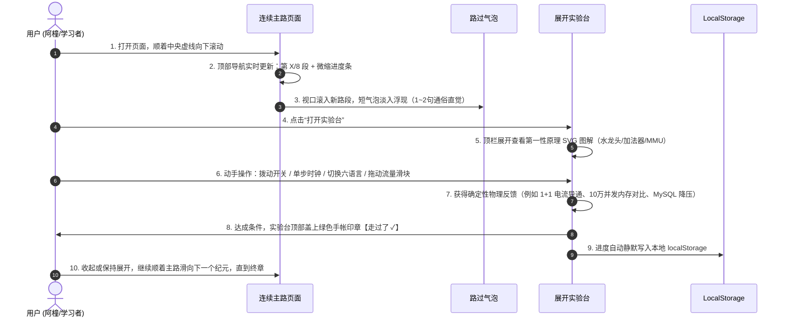

# 代码世界：UI 界面草稿设计规范与全流程走查

> 本文档规范了《代码世界》前端界面的**视觉设计规范**、**组件线框图（Wireframe）**与**端到端用户走查流程（User Flow）**。

---

## 一、 视觉设计规范（手帐暖奶茶风）

### 1. 配色语义系统

| 色系 | 色值 | 语义用途 |
| :--- | :--- | :--- |
| **暖奶茶底色 (Tea Base)** | `#f6ede3` / `#f5e6d3` | 全局背景，如羊皮纸/温润手帐，低刺激、护眼 |
| **卡片乳白底 (Card Light)** | `#fffcf8` / `#fff8f0` | 实验台卡片、图解面板背景，纯净温润 |
| **抹茶绿 (Matcha Green)** | `#7a9e7e` (主) / `#5e8362` (深) | “通关盖章”、“高电平导通 1”、“稳健架构”状态 |
| **蜜桃红 (Peach Red)** | `#e8a0a0` (主) / `#cc7a7a` (深) | “路过气泡提醒”、“低电平/告警”、“高负载飙红” |
| **墨茶文字 (Text Main)** | `#4a3f35` | 正文标题、高对比度阅读文本 |
| **淡茶副文本 (Text Muted)** | `#8c7e71` | 说明旁白、寄存器注释、低调辅助说明 |
| **奶咖边框 (Border)** | `#e6d7c5` | 圆角卡片外边框、虚线导线、分割线 |

---

## 二、 全局界面结构线框图（UI Wireframe）

```
+-----------------------------------------------------------------------------------+
| [TOPBAR 吸顶状态栏]                                                               |
|  代码世界 · 架构师之路   |  顺着路往下走 · 第 5/8 段 · 六大编程语言架构大比拼     | 走过 5/8 [====   ] |
+-----------------------------------------------------------------------------------+
|                                                                                   |
|    [INTRO 序幕手帐卡片]                                                           |
|    从物理开关到系统与大模型架构师                                                  |
|    拒绝浮躁与黑盒：因果相连的连续探索之路，每一站都有第一性原理图解与可动手实操台  |
|                                                                                   |
|  : (时间轴虚线)                                                                   |
|  O [MILESTONE 01 节点]                                                            |
|  |   [HINT 气泡] 💬 计算机底层只认识电平高低，8个开关就能拼出人类所有字符...          |
|  |   +-------------------------------------------------------------------------+  |
|  |   | [LAB CARD 01 展开态] 第 1 纪元 · 电、开关与比特编码      [走过了 ✓ 绿章] |  |
|  |   | > 第一性原理：MOSFET 晶体管闸门水龙头图解 (SVG)                         |  |
|  |   | > 8 位物理开关面板：[O] [X] [X] [X] [X] [X] [X] [O]                    |  |
|  |   | > 实时换算屏：二进制 01000001 | 十进制 65 | ASCII 字符 'A'              |  |
|  |   +-------------------------------------------------------------------------+  |
|  :                                                                                |
|  O [MILESTONE 02 节点]                                                            |
|  |   +-------------------------------------------------------------------------+  |
|  |   | [LAB CARD 02 展开态] 第 2 纪元 · 逻辑门与加法器电路      [走过了 ✓ 绿章] |  |
|  |   | > 半加器电路 SVG：输入 A [1] + 输入 B [1]                               |  |
|  |   |   - 异或门 XOR ➔ 本位 Sum: 0 (绿色通电导线)                             |  |
|  |   |   - 与门 AND   ➔ 进位 Carry: 1 (红色高电平导线)                         |  |
|  |   | > 实时结算：1 + 1 = 2 ➔ 二进制 [Carry:1][Sum:0] = 10 (亲眼见证物理生成) |  |
|  |   +-------------------------------------------------------------------------+  |
|  :                                                                                |
|  O [MILESTONE 05 节点 - 重头戏]                                                   |
|  |   +-------------------------------------------------------------------------+  |
|  |   | [LAB CARD 05 展开态] 第 5 纪元 · 六大编程语言架构大比拼                  |  |
|  |   | [Tabs]: [C/C++]  [*Rust*]  [Go]  [Java]  [Python]  [TypeScript]         |  |
|  |   | ----------------------------------------------------------------------- |  |
|  |   | [架构能力雷达]: 性能 5/5 | 内存安全 5/5 | 并发 5/5 | 心智 3/5          |  |
|  |   | [底层机制三支柱]: 执行模型 AOT | 内存所有权借用检查 | 无畏并发           |  |
|  |   | [同一场景同台代码]: Rust std::sync::atomic::AtomicUsize 无锁并发计数器  |  |
|  |   | [架构师压力沙盘]: [🚀 施压 10 万并发长连接！观察各语言内存开销 (80MB~100GB)] |  |
|  |   +-------------------------------------------------------------------------+  |
|  :                                                                                |
|  O [MILESTONE 06 节点 - 系统架构沙盘]                                             |
|  |   +-------------------------------------------------------------------------+  |
|  |   | [LAB CARD 06 展开态] 第 6 纪元 · 分布式高并发系统架构沙盘               |  |
|  |   | [流量滑块]: 500 QPS =========[ 15,000 QPS 洪峰 ]========= 50,000 QPS    |  |
|  |   | [架构师武器]: [✅ 部署 Redis]  [✅ 部署 Kafka]  [✅ 部署 Sentinel 限流]   |  |
|  |   | [动态拓扑图]: Client ➔ Nginx ➔ Redis(命中85%) ➔ Kafka ➔ MySQL(负载15%)  |  |
|  |   +-------------------------------------------------------------------------+  |
|  :                                                                                |
|  O [MILESTONE 08 节点 - 大模型推理]                                               |
|  |   +-------------------------------------------------------------------------+  |
|  |   | [LAB CARD 08 展开态] 第 8 纪元 · Transformer 与大模型推理架构           |  |
|  |   | > 点击 Token 查看注意力热力图: [小明] [把] [红色] [的] [苹果] [递给]   |  |
|  |   | > 自回归生成吐字模拟 ➔ 动态观测 KV Cache 显存占用从 8MB 涨到 128MB+     |  |
|  |   | > 揭示显存带宽墙瓶颈 (Memory-Bound) 与 PagedAttention 架构革命          |  |
|  |   +-------------------------------------------------------------------------+  |
|                                                                                   |
|  [ENDING 终章手帐]                                                                |
|  🎉 八大纪元全部走过！你已完成从电平物理通断到系统架构与大模型推理的心智闭环！   |
|  [重置进度按钮] (清空 localStorage 进度)                                          |
+-----------------------------------------------------------------------------------+
```

---

## 三、 用户端到端走查动线（User Flow Walkthrough）



---

## 四、 核心体验设计细节

1. **零阻碍自由滚动**：绝不强制“前一段没做完不准看后一段”。用户可以一路滑到底看完风景，也可以随时返回任何一段展开实操。
2. **多语言对比台**：将 C++、Rust、Go、Java、Python、TypeScript 的选项卡设计在显眼头部，切换时无重载刷新，能力雷达、机制卡片与代码区瞬时联动。
3. **视觉减负**：专业图示（如时钟波形、微机总线、系统拓扑）采用 SVG 矢量绘制，带微动效高亮，告别大段晦涩文字说明。
